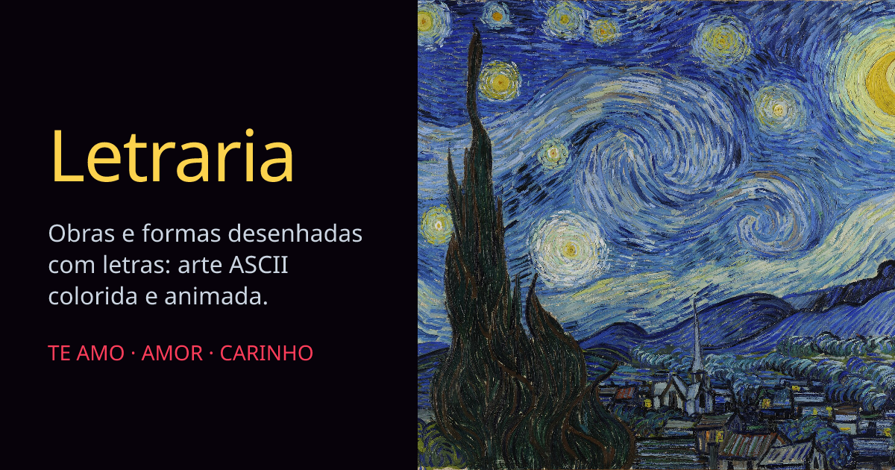

<div align="center">



# Letraria

**Obras e formas desenhadas com letras.**<br />
Arte ASCII colorida e animada: pinturas que se revelam com zoom, formas que se desenham e se preenchem com palavras de carinho.

<br />

[](https://letraria.vercel.app)


</div>

<br />

## ✨ O que dá para fazer

| Recurso | Descrição |
|---|---|
| **Galeria** | A página inicial reúne as obras em cartões com miniaturas em ASCII, que cintilam ao passar o mouse. Clique em um para abrir a animação em tela cheia. |
| **Seis obras clássicas** | *A Noite Estrelada*, *Os Girassóis*, *O Beijo*, *A Grande Onda de Kanagawa*, *Moça com Brinco de Pérola* e *O Grito* viram texto colorido, com moldura dourada também em ASCII. O zoom começa no centro e se afasta até mostrar a obra inteira. |
| **Sobre a obra** | Quando o zoom termina, o botão "Sobre a obra" abre um painel com três partes: o contexto em que a obra foi feita, a mensagem que ela passa e uma curiosidade. Fecha com o ✕, clicando fora ou com Esc. O painel traz também o link do arquivo de origem na Wikimedia Commons. |
| **Coração de palavras** | Um contorno de coração se desenha de baixo para cima e depois se preenche com "TE AMO", "CARINHO", "ABRAÇO" e outras palavras, em tons de vermelho. |
| **Navegação entre obras** | Na página de cada obra, as setas levam à anterior e à próxima. Há também botões para repetir o zoom e para tela cheia. |
| **Repetir a animação** | Clique na tela ou no botão "Repetir" para rever o zoom ou o desenho do coração. |
| **Movimento reduzido** | Se o seu sistema pede menos animação, as obras aparecem já prontas, sem zoom nem desenho progressivo. |

## 🧠 Como funciona

| Conceito | Regra |
|---|---|
| **Pixels viram letras** | A pintura é lida célula a célula. O brilho de cada trecho escolhe o caractere (`.,:;-=+*xo#%&@`) e a cor dele vem do próprio trecho, com um fundo mais escuro da mesma cor. |
| **Zoom** | O zoom parte de 16× e cai de forma suave até 1×, sempre centrado no meio da obra. |
| **Identidade visual** | Três cores: dourado (moldura e destaques), azul-noite (fundo) e rubi (coração), definidas em `app/globals.css`. Títulos em Fraunces e rótulos em JetBrains Mono, via `next/font`. |
| **Introdução** | Ao abrir uma obra, a moldura se desenha em diagonal, a pintura surge de dentro dela e só então o zoom começa. |
| **Moldura** | Quatro anéis de caracteres dourados (`#@`, `~o`, `=-`, `'.`), mais claros no canto superior esquerdo e mais escuros no inferior direito. |
| **Coração** | A forma vem da equação clássica do coração. As células de borda formam o contorno e o interior recebe as palavras, embaralhadas e deslocadas linha a linha. |

Tudo é desenhado com `<canvas>` 2D, sem biblioteca de gráficos.

## 🚀 Rodando localmente

Requer [Node.js](https://nodejs.org) 18.18 ou superior e npm.

```bash
git clone https://github.com/diegonatalo/Letraria.git
cd Letraria
npm install
npm run dev     # http://localhost:3000
```

| Comando | O que faz |
|---|---|
| `npm run dev` | Servidor de desenvolvimento |
| `npm run build` | Gera o build de produção |
| `npm start` | Serve o build de produção |

## 🗂️ Estrutura

```text
app/
├── page.tsx                galeria (página inicial)
├── [slug]/                 uma página por obra (/noite-estrelada, /o-beijo, ...)
├── coracao/                página do coração de palavras
├── layout.tsx              metadados, Open Graph e Twitter
├── opengraph-image.tsx     imagem de compartilhamento (1200×630)
├── icon.svg                favicon
├── robots.ts               /robots.txt
└── sitemap.ts              /sitemap.xml
components/
├── AsciiArtwork.tsx        renderizador de qualquer pintura, com zoom, moldura e painel "Sobre a obra"
├── AsciiHeart.tsx          contorno e preenchimento do coração
├── AsciiThumb.tsx          miniatura em ASCII dos cartões da galeria
├── AsciiLogo.tsx           logotipo "LETRARIA" em caracteres
├── AsciiRain.tsx           chuva de letras do fundo da galeria
└── BackLink.tsx            botão "← Galeria"
lib/
├── ascii.ts                escala de caracteres e fonte compartilhadas
└── works.ts                lista das obras (título, artista, ano, fonte e textos do painel "Sobre a obra")
public/obras/               imagens reduzidas e miniaturas das obras
docs/img/
└── banner.png              banner deste README
```

<details>
<summary><b>Como adicionar uma nova obra</b></summary>

1. Baixe uma versão reduzida (de 1280 a 1920 px de largura) de uma obra em domínio público, por exemplo na [Wikimedia Commons](https://commons.wikimedia.org), e uma miniatura de 480 px.
2. Salve as duas em `public/obras/<slug>.jpg` e `public/obras/<slug>-thumb.jpg`.
3. Adicione a obra à lista `WORKS` em `lib/works.ts`, com `about` contendo três textos, nesta ordem: contexto, mensagem e curiosidade. Confira os fatos em fontes confiáveis antes de escrever.

A página, a galeria, o painel "Sobre a obra", os metadados e o sitemap saem dessa lista.

</details>

## 🌐 Deploy

O projeto foi pensado para a [Vercel](https://vercel.com) e não precisa de configuração extra nem de variáveis de ambiente.

> [!NOTE]
> O domínio `https://letraria.vercel.app` está escrito em `app/layout.tsx` (`metadataBase`), em `app/sitemap.ts` e em `app/robots.ts`. Ao mudar de domínio, troque nos três lugares, senão o Open Graph, o sitemap e o canonical continuam apontando para o endereço antigo.

## 🧭 Próximos passos

- [ ] Mais obras e formas na galeria.
- [ ] Gerar um `favicon.ico` para leitores antigos (hoje só existe o SVG).
- [ ] Testar o desempenho em celulares mais simples. A animação redesenha milhares de células por quadro.
- [ ] Testes automatizados. Hoje não há nenhum.

## Créditos

- Obras em domínio público, em versões reduzidas da [Wikimedia Commons](https://commons.wikimedia.org). O link de cada arquivo de origem está em `lib/works.ts`:
  *A Noite Estrelada* e *Os Girassóis* (Van Gogh), *O Beijo* (Klimt), *A Grande Onda de Kanagawa* (Hokusai), *Moça com Brinco de Pérola* (Vermeer) e *O Grito* (Munch).
- O código foi escrito com apoio do Claude Code.

<br />

<div align="center">
  <sub>Feito com 💛 para quem gosta de ver arte sendo escrita.</sub>
</div>
